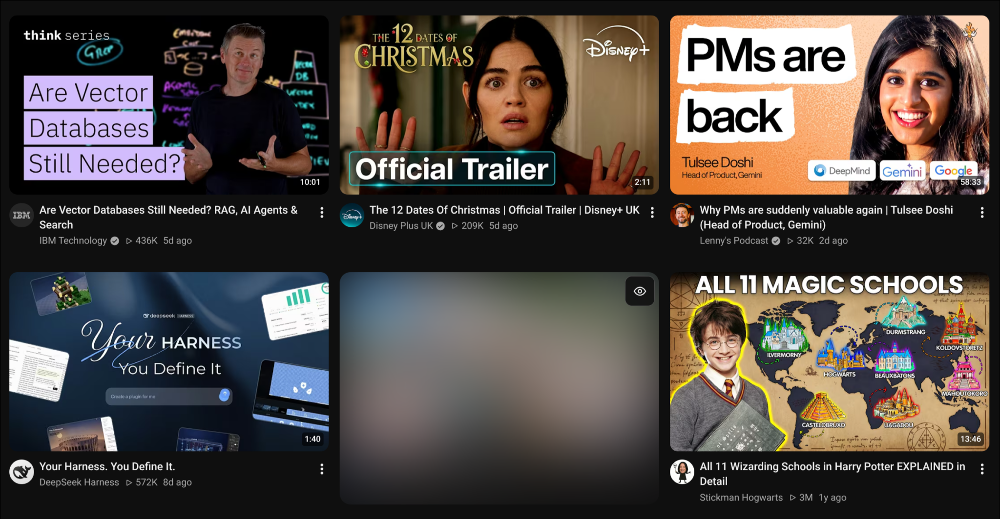
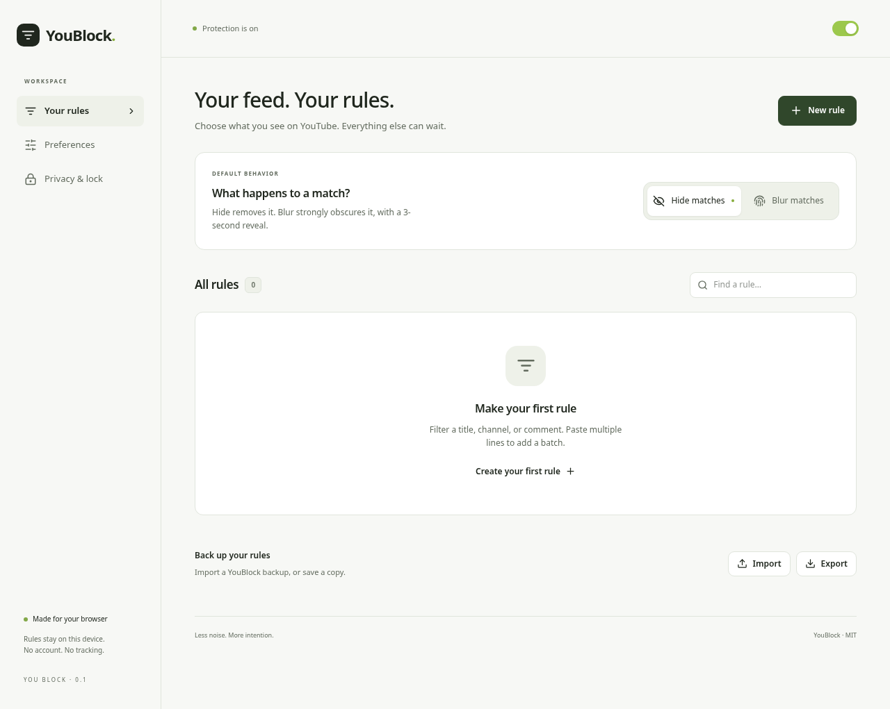

# YouBlock

**A quieter YouTube.** Hide distractions or strongly blur matching videos and comments, while keeping the rest of your feed in view. YouBlock is a Chrome and Firefox extension with local filter rules and a minimal React + Magic UI interface, licensed under MIT.



**Your feed, with a little breathing room.** Match titles, channels, video IDs, or comment text. Choose Hide or Blur, paste one rule per line, and use the eye button for a three-second reveal with smooth transitions. Rules stay on your device; no account is needed.

> Development preview. Browser packaging and automated checks do not establish complete live YouTube parity. See [coverage](docs/COVERAGE.md) and [verification](docs/VERIFICATION.md) before relying on filtering.

## Build and package

Requires Node.js 22+ and npm.

```sh
npm ci
npm test
npm run package
```

Build outputs:

| Output | Use |
| --- | --- |
| `dist/chrome/` | Load unpacked in Chrome |
| `dist/firefox/` | Load temporarily in Firefox |
| `artifacts/youblock-chrome-<version>.zip` | Unzip for Chrome developer mode; source for a later Web Store submission |
| `artifacts/youblock-firefox-<version>.zip` | Firefox temporary installation / source for Mozilla signing |
| `artifacts/SHA256SUMS` | Package integrity checksums |

### Tagged GitHub releases

Each release uses a stable `vX.Y.Z` Git tag and attaches both browser ZIPs plus `SHA256SUMS` to a GitHub Release. Download these assets rather than GitHub’s automatic source archives. `package.json` supplies the version for both manifests and filenames; the release workflow rejects tags or lockfile versions that do not match it.

From a clean, up-to-date checkout on `main`:

```sh
npm ci
npm test
npm run test:package
npm version patch                 # or minor / major; commits the version and creates vX.Y.Z
# Use the newly created tag below, for example v0.1.1:
git push origin main
git push origin v0.1.1
```

Pushing the tag starts `.github/workflows/release.yml`: validate the version, run tests, build and inspect both ZIPs, then upload the assets to a draft release and publish it. No personal access token is required; the publishing job uses GitHub’s repository token with `contents: write`. A failed upload leaves a draft for inspection; delete that draft before rerunning the workflow. Do not move published version tags; release fixes with a new version. No release is created until a tag is pushed.

These are developer-install packages. Chrome requires extracting the ZIP and **Load unpacked**; a downloadable CRX is not a general installation solution on Windows/macOS. The Firefox ZIP is unsigned and supports temporary installation only. A permanently installable, drag-and-drop Firefox XPI requires Mozilla signing with an AMO account/API credentials and a separate signing process; renaming the ZIP does not work. See [Chrome distribution](https://developer.chrome.com/docs/extensions/how-to/distribute) and [Mozilla signing](https://extensionworkshop.com/documentation/publish/signing-and-distribution-overview/).

### Chrome

1. Run `npm run package` (or unzip the Chrome ZIP into a folder).
2. Open `chrome://extensions`, enable **Developer mode**, choose **Load unpacked**.
3. Select `dist/chrome` (or the extracted folder containing `manifest.json`).
4. Pin YouBlock. Open YouTube or reload existing tabs after installation or extension updates.

After reloading or updating YouBlock, reload existing YouTube tabs to reconnect their content scripts. Stale tabs retain their last filters and show a reload notice instead of retrying invalid extension APIs.

Chrome developer-mode installation uses an unpacked directory, not the ZIP itself. This repository does not publish to the Chrome Web Store.

### Firefox desktop

1. Run `npm run package`.
2. Open `about:debugging#/runtime/this-firefox`, choose **Load Temporary Add-on**.
3. Select `dist/firefox/manifest.json`, or the Firefox ZIP.
4. Reload YouTube tabs. Temporary add-ons are removed when Firefox restarts.

Permanent installation in standard Firefox requires [Mozilla signing](https://extensionworkshop.com/documentation/publish/signing-and-distribution-overview/). Renaming an unsigned ZIP to XPI does not sign it. A signed build and AMO publication are separate steps; no signing credentials are needed for local builds.

### Firefox for Android

The manifest targets Firefox Android and `m.youtube.com`. Use [Mozilla's Android extension development workflow](https://extensionworkshop.allizom.org/documentation/develop/developing-extensions-for-firefox-for-android/) with a connected test device and `web-ext run --target=firefox-android --source-dir=dist/firefox`. Android SDK, ADB, and web-ext are separate development prerequisites. Permanent installation requires a signed, compatible add-on. Android behavior has not yet been verified on a device.

Chrome for Android is not a supported extension target. Kiwi is not advertised as supported: [the project ended maintenance in January 2025](https://github.com/kiwibrowser/src.next/blob/kiwi/README.md).

## Filtering



- Set a global **Hide** or **Blur** default. Each rule can inherit or override it; Hide wins when several rules match.
- Match video titles, channel/author names, channel/author IDs, video IDs, or comment text. Keywords match whole words case-insensitively; `/regex/i` supports advanced expressions. IDs match exactly. Names are not unique channel identities.
- Blur applies a strong 48px blur to the original content, with rounded corners and an eye icon labeled **Reveal for 3 seconds**. Matching content stays out of interaction/accessibility until revealed; preview playback is paused/muted. The three-second reveal window includes short reveal and return-to-blur transitions. Keyboard activation and reduced-motion mode stay instant. Initial filtering still applies immediately. Matching is based on metadata, not image recognition. Blur preserves colors and rough shapes; choose Hide to remove matching content entirely.
- Search watch-card panels match their own heading; hero and compact videos inside a nonmatching panel are filtered independently. Rules match the actual metadata: a keyword such as `GTA 6` does not automatically expand to `Grand Theft Auto VI`. Use multiple lines or `/gta\s*6|grand theft auto/i` to cover both titles.
- Add rules from the popup or searchable rule manager. Paste one keyword, ID, or regex per line to add several rules at once; blank lines are ignored and the selected field/action applies to every entry. Invalid lines are numbered and the entire batch stays unsaved until corrected. The popup saves immediately; settings changes apply after **Save changes**.
- Additional controls cover Shorts, Mixes, movies, Trending/Explore, duration ranges, watched percentage, recommendations-only filtering, autoplay progression, history exceptions, inactivity prompts, and audio normalization.
- Quick-block menu entries request confirmation and offer Undo. Protected settings require unlocking in the extension UI; quick blocking is denied while password protection is active.
- Hide-mode autoplay can advance to a known permitted subsequent playlist item or recommendation. If no eligible candidate is known, playback stays paused. Blur waits for deliberate reveal and resumes after three seconds.

YouTube changes its renderer data and markup frequently. Known-card startup concealment is bounded; if the settings bridge cannot initialize within 2.5 seconds, it fails open. Universal first-frame or audio-leak protection is not guaranteed. Unsupported layouts must be recorded rather than assumed covered.

## Privacy and protected settings

Rules stay in local browser storage; there is no account, backend, analytics, or external asset loading. The extension runs only on `www.youtube.com` and `m.youtube.com` and requests `storage`. YouTube itself continues its normal network activity. The optional feedback setting requests native “Not interested” feedback after confirmation when a card exposes that action; service-side handling remains unverified.

Settings passwords use salted PBKDF2 hashes. Unlock grants an in-memory token lasting 15 minutes; explicit lock or a background restart invalidates it. Tokens are never sent to YouTube pages. This is a settings gate, not encryption or protection against the browser owner resetting/removing the extension. **Forgot password / Reset** deletes all rules, preferences, and protection; export a backup first if possible.

Imports accept YouBlock backups and legacy `filterData`/`options` JSON. They do not import passwords. Imported custom JavaScript is always disabled until explicitly enabled again. Custom JavaScript executes in YouTube's page context, requires trusted code, and may be restricted by browser/page policy; it does not grant extension API access. Regular expressions can still be expensive: avoid pathological expressions.

## Development and checks

```sh
npm run check       # TypeScript
npm test            # Matching, concealment and protected background operations
npm run build       # Both extension directories
npm run package     # Both ZIPs and SHA256SUMS
npm run test:chrome # Isolated actual-package smoke (requires a Chrome for Testing executable)
npm run test:popup  # Actual toolbar popup sizing, editor/errors, and badge regression checks
npm run test:search # Injected watch-card matching, real blur, reveal, Hide and restoration
npm run test:reload # Extension-context invalidation and fresh-tab recovery
npm run test:menu   # Confirmation, exact-ID blocking, optional feedback and Undo
npm run test:engine # Independent response hooks, predicates and metadata controls
```

Set `CHROME_PATH` to a browser executable that supports command-line extension loading. Recent branded Chrome versions may disable that flag; use Chrome for Testing. Tests never use your normal browser profile. For example, install a task-local test browser with `PLAYWRIGHT_BROWSERS_PATH=node_modules/.cache/pw npx playwright install chromium`, then set `CHROME_PATH` to its executable under that directory.

`npm run dev` serves extension UI sources, but extension APIs require running the built extension. No mock settings are silently substituted in the product.

See the [coverage matrix](docs/COVERAGE.md), [verification evidence](docs/VERIFICATION.md), [MIT license](LICENSE), and [third-party notices](THIRD_PARTY_NOTICES.md).
